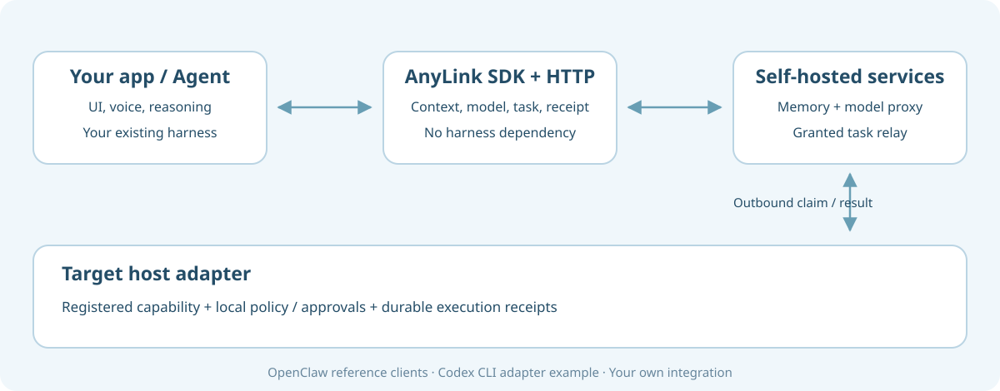
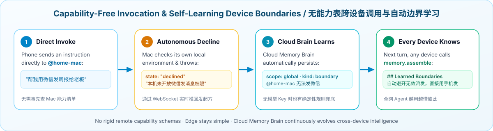
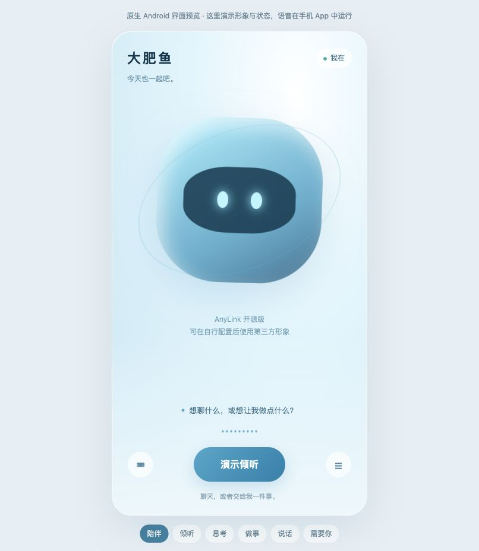
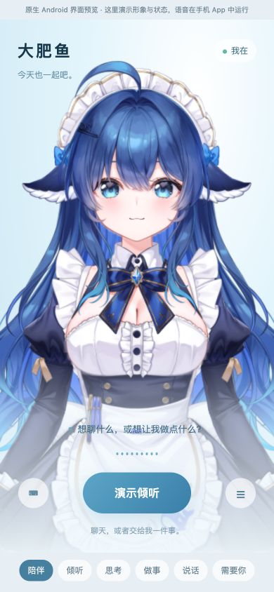

<p align="center">
  
</p>

<h1 align="center">AnyLink Agent</h1>

<p align="center">
  <strong>Personal Agent Network — Centralized Cloud Memory Brain &amp; Model Gateway, Autonomous Edge Agents on Every Device.</strong>
</p>

<p align="center">
  <a href="README.zh-CN.md"></a>
  <a href="protocol/README.md"></a>
  <a href="sdk-python/README.md"></a>
  <a href="sdk/README.md"></a>
  <a href="mcp/README.md"></a>
  <a href="LICENSE"></a>
</p>

<p align="center">
  <a href="#why-anylink">Why AnyLink</a> ·
  <a href="#architecture">Architecture</a> ·
  <a href="#connect-in-10-lines">Quickstart</a> ·
  <a href="#reference-showcase-clients">Showcase Clients</a> ·
  <a href="#self-host-the-cloud-hub">Self-Hosting</a> ·
  <a href="protocol/README.md">Protocol v3 Spec</a>
</p>

---

## Why AnyLink?

Most AI agents are trapped on a single machine: your laptop agent has no idea what you just discussed on your phone, your Linux servers run isolated scripts, and connecting devices requires brittle capability tables and high-latency polling.

**AnyLink introduces a clean "Cloud Memory Brain + Autonomous Edge" architecture for Personal Agent Networks:**

| Dimension | Traditional Single-Device Agents | **AnyLink Protocol v3** |
| --- | --- | --- |
| **Shared Memory** | Siloed local markdown/DB per machine | **Cloud Memory Brain**: hybrid CJK/Latin + optional vector assembly, debounced batch consolidation & deduplication across all devices |
| **Model Gateway** | API keys scattered across devices | **Central Multi-Model Gateway**: keys stay on your server, multi-provider aliases, per-agent concurrency & optional Auto-Memory (`X-AnyLink-Auto-Memory: on`) |
| **Cross-Device Invocation** | Rigid remote capability tables & slow HTTP polling | **Real-Time WebSocket Bus + Capability-Free Invoke**: route by unique `@device_slug` with live progress push & lease heartbeats |
| **Boundary Discovery** | Manually maintained remote schemas | **Self-Learning Device Boundaries**: receivers autonomously return `declined` + reason; Cloud Memory Brain learns it for every device automatically |
| **Ecosystem** | Locked to one agent framework | **Harness-Independent**: ships with **Python SDK (PyPI)**, **TypeScript SDK (npm)**, and **Zero-Code MCP Server** |

<p align="center">
  
</p>

---

## Architecture

<p align="center">
  
</p>

### Capability-Free Invocation & Self-Learning Boundaries

Edge agents **only manage their own local environment and safety policy** — they never maintain remote capability matrices:

<p align="center">
  
</p>

- **Unique Short Device Slugs (`device_slug`)**: Address multiple machines cleanly (`@home-mac`, `@office-mac`, `@gpu-box`). Ambiguous display names return `409 AMBIGUOUS_TARGET_DEVICE` with candidate slugs.
- **Smart Debouncing & Chitchat Filtering**: Rapid turns in the same session are debounced (default 15s / 6 turns) into a **single** Cloud Memory consolidation call, while trivial greetings ("ok / hi") are skipped at zero LLM cost. Declined/failed task boundaries consolidate immediately.
- **Crash-Safe Reliability**: Idempotent writes, zero-dependency durable JSONL local journals (`FileJournal`), heartbeat lease expiry (`LEASE_EXPIRED` → `unknown`), and zero blind side-effect retries.

---

## Connect in 10 Lines

### 1. Python SDK (`anylink-agent` · PyPI) — Linux Servers, Scripts, LangGraph, CrewAI

```bash
pip install anylink-agent   # or from source: uv pip install -e ./sdk-python
```

```python
import asyncio, os
from anylink import AnyLinkAgent, AnyLinkClient, TaskContext, TaskDeclined

async def main():
    joined = await AnyLinkClient.connect(
        base_url=os.environ["ANYLINK_BASE_URL"], join_key=os.environ["ANYLINK_JOIN_KEY"],
        install_id="gpu-server-01", device_name="GPU Server", device_slug="gpu-box",
        platform="linux", agent_key="worker", agent_name="GPU Agent",
    )
    async with AnyLinkClient(os.environ["ANYLINK_BASE_URL"], joined["token"]) as client:
        mem = await client.assemble_memory(query="Which training run is active?")
        reply = await client.chat_completions(model="default", messages=[{"role": "user", "content": "Summarize progress"}], auto_memory=True)

        agent = AnyLinkAgent(client, journal_path="./private-state/journal.jsonl")

        @agent.on_invoke
        async def handle(task: dict, ctx: TaskContext):
            if "wechat" in (task.get("instruction") or "").lower():
                raise TaskDeclined("UNSUPPORTED", "This Linux server cannot access WeChat")
            await ctx.report_progress(stage="working", message="Checking GPU...", percent=50)
            return {"reply": f"Completed on gpu-box: {task['instruction']}"}

        await agent.run()

asyncio.run(main())
```

### 2. TypeScript SDK (`@anylink-agent/sdk` · npm) — Zero Dependencies, Node >= 22

```js
import { AnyLinkClient } from '@anylink-agent/sdk';

const joined = await AnyLinkClient.connect({
  baseUrl: process.env.ANYLINK_BASE_URL, joinKey: process.env.ANYLINK_JOIN_KEY,
  installId: 'home-mac-01',
  device: { name: 'MacBook Pro', slug: 'home-mac', platform: 'macos' },
  agent: { key: 'desktop', name: 'Mac Agent' },
});
const client = new AnyLinkClient({ baseUrl: process.env.ANYLINK_BASE_URL, token: joined.token });

const task = await client.invoke({ target: { device_slug: 'gpu-box' }, instruction: 'Check current VRAM usage' });
const done = await client.waitForTask(task.id);
```

### 3. Zero-Code MCP Server (`@anylink-agent/mcp`) — Claude Code, Cursor, Codex, OpenClaw

```json
{
  "mcpServers": {
    "anylink": {
      "command": "node",
      "args": ["/path/to/anylink-agent/mcp/bin/anylink-mcp.mjs"],
      "env": {
        "ANYLINK_BASE_URL": "https://your-anylink-server.example",
        "ANYLINK_TOKEN": "ak_..."
      }
    }
  }
}
```

---

## Reference Showcase Clients

While the core protocol and SDKs are 100% neutral and character-free, this repository also includes companion showcase apps featuring the deep-sea blue whale mascot **"蓝色大肥鱼 (Dafeiyu)"**:

- **macOS (OpenClaw Reference Harness)**: Cloud memory plugin, sandboxed local file tools, desktop Live2D companion & voice interaction.
- **Android (Native On-Device Agent)**: Runs independently even when Mac is offline; voice chat, floating overlay, accessibility phone control, and seamless cross-device delegation to Mac.

<p align="center">
  
  
</p>

<p align="center">
  <sub>Left: original public placeholder artwork. Right: optional third-party character configured locally (desktop browser composition previews, not hardware screenshots).<br/>
  Public packages <strong>exclude</strong> third-party Live2D models, textures, and Cubism Core. See <a href="THIRD_PARTY_NOTICES.md">THIRD_PARTY_NOTICES.md</a>.</sub>
</p>

---

## Self-Host the Cloud Hub

Requirements: Node 22+, npm, Docker Compose (standard PostgreSQL 16/17 — no special DB extensions required).

```bash
git clone https://github.com/windowssr/AnyLink-Agent.git
cd AnyLink-Agent
npm ci
node scripts/init-local.mjs
# Optional: configure DEEPSEEK_API_KEY or ANYLINK_MODELS_JSON in .env (never commit .env)
docker compose --env-file .env -f deploy/compose.local.yaml up -d --wait
npm run build
node --env-file=.env dist/server/index.js
```

Open `http://127.0.0.1:3180` and sign in with `secrets/local-dev-owner-token`. See [docs/open-source/self-hosting.md](docs/open-source/self-hosting.md) for HTTPS & production deployment.

---

## Repository Layout & Roadmap

```text
protocol/       # Protocol v3 spec & generated OpenAPI 3.1 contract
server/         # Cloud Hub (Memory Brain, Multi-Model Gateway, WebSocket Bus, Admin API)
sdk/            # @anylink-agent/sdk — Zero-dependency JS/TS SDK (npm)
sdk-python/     # anylink-agent — Async Python SDK & decorator edge node (PyPI)
mcp/            # @anylink-agent/mcp — Stdio MCP server for Claude Code / Cursor / Codex
web/            # Owner administration console (React + Vite)
mac/            # Reference showcase: Mac OpenClaw plugins & desktop companion
android-native/ # Reference showcase: Native Android companion agent
```

- [x] **Phase 1**: Protocol v3.0, Cloud Memory Brain (hybrid search + debounced batch consolidation + auto boundary learning), Multi-Model Gateway + 1A Auto-Memory, WebSocket real-time bus + lease reaper, unique device slugs, Python SDK, TypeScript SDK, MCP Server.
- [x] **Phase 2**: Migrated Mac OpenClaw plugins & workers (hot token reload, v3 `memory/assemble` & `memory/ingest`, `anylink_invoke`, WebSocket bus, `[ANYLINK_DECLINED]` boundary feedback) and Android native companion app (OkHttp WebSocket push, proactive spoken `task.completed` results, thread-safe isolated `CloudClient`, `device_slug` onboarding, `task_invoke` + `declined` boundary learning) to Protocol v3.
- [ ] **Phase 3**: Publish `anylink-agent` to PyPI and `@anylink-agent/sdk` + `@anylink-agent/mcp` to npm, plus community adapters (LangGraph, CrewAI, AutoGen).

---

## License & Mirrors

Original code, diagrams, artwork, and documentation are [MIT licensed](LICENSE). See [SECURITY.md](SECURITY.md) and [CONTRIBUTING.md](CONTRIBUTING.md).
Mirrored on [GitHub](https://github.com/windowssr/AnyLink-Agent) and [Gitee](https://gitee.com/windowssr/anylink-agent). If you like the "Cloud Memory Brain + Autonomous Edge" approach, drop a **Star** or open a PR!
