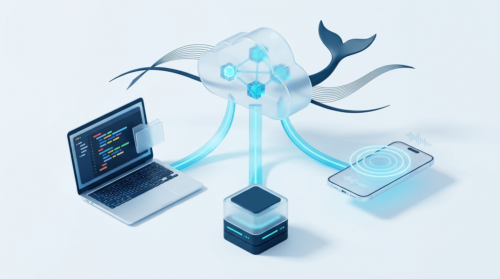

<p align="center">
  
</p>

<h1 align="center">AnyLink Agent</h1>

<p align="center">
  <strong>Personal Agent Network — Centralized Cloud Memory Brain &amp; Model Gateway, Autonomous Edge Agents on Every Device.</strong>
</p>

<p align="center">
  <a href="README.zh-CN.md"></a>
  <a href="protocol/README.md"></a>
  <a href="https://github.com/windowssr/AnyLink-Agent/releases/tag/v0.9.0"></a>
  <a href="sdk-python/README.md"></a>
  <a href="sdk/README.md"></a>
  <a href="mcp/README.md"></a>
  <a href="LICENSE"></a>
</p>

<p align="center">
  <a href="#why-anylink">Why AnyLink</a> ·
  <a href="#architecture">Architecture</a> ·
  <a href="#connect-in-10-lines">Quickstart</a> ·
  <a href="#reference-showcase-clients">Showcase Clients</a> ·
  <a href="#self-host-the-cloud-hub">Self-Hosting</a> ·
  <a href="protocol/README.md">Protocol v3 Spec</a>
</p>

---

## Why AnyLink?

Most AI agents are trapped on a single machine: your laptop agent has no idea what you just discussed on your phone, your Linux servers run isolated scripts, and connecting devices requires brittle capability tables and high-latency polling.

**AnyLink introduces a clean "Cloud Memory Brain + Autonomous Edge" architecture for Personal Agent Networks:**

| Dimension | Traditional Single-Device Agents | **AnyLink Protocol v3** |
| --- | --- | --- |
| **Shared Memory** | Siloed local markdown/DB per machine | **Cloud Memory Brain**: hybrid CJK/Latin + optional vector assembly, debounced batch consolidation & deduplication across all devices |
| **Model Gateway** | API keys scattered across devices | **Central Multi-Model Gateway**: keys stay on your server, multi-provider aliases, per-agent concurrency & optional Auto-Memory (`X-AnyLink-Auto-Memory: on`) |
| **Cross-Device Invocation** | Rigid remote capability tables & slow HTTP polling | **Real-Time WebSocket Bus + Capability-Free Invoke**: route by unique `@device_slug` with live progress push & lease heartbeats |
| **Boundary Discovery** | Manually maintained remote schemas | **Self-Learning Device Boundaries**: receivers autonomously return `declined` + reason; Cloud Memory Brain learns it for every device automatically |
| **Ecosystem** | Locked to one agent framework | **Harness-Independent**: ships with **Python SDK (PyPI)**, **TypeScript SDK (npm)**, and **Zero-Code MCP Server** |

<p align="center">
  
</p>

---

## Architecture

<p align="center">
  
</p>

### Capability-Free Invocation & Self-Learning Boundaries

Edge agents **only manage their own local environment and safety policy** — they never maintain remote capability matrices:

<p align="center">
  
</p>

- **Simple Login Password (`ANYLINK_LOGIN_PASSWORD`)**: Optional memorable server passcode (≥6 chars) so non-technical users can connect Android/Mac apps and sign into the Web Admin Console with just the server URL + password (automatically exchanges for an encrypted high-entropy device token; password is never stored on disk).
- **Unique Short Device Slugs (`device_slug`)**: Address multiple machines cleanly (`@home-mac`, `@office-mac`, `@gpu-box`). Ambiguous display names return `409 AMBIGUOUS_TARGET_DEVICE` with candidate slugs.
- **Smart Debouncing & Chitchat Filtering**: Rapid turns in the same session are debounced (default 15s / 6 turns) into a **single** Cloud Memory consolidation call, while trivial greetings ("ok / hi") are skipped at zero LLM cost. Declined/failed task boundaries consolidate immediately, with crash recovery and per-owner serialization.

### Protocol v3.2 Resilient Task State Machine & Multi-Agent Primitives

Designed for real-world mobile networks, NAT drops, sleeping laptops, and multi-agent loops:

<p align="center">
  
</p>

- **Network-Hardened WebSocket Bus**: Application-level ping/pong zombie eviction, slow-consumer backpressure guard, monotonic `edge_events` sequence cursor (`resume_after_seq`) with zero-gap replay, and explicit receipt delivery ACKs (`task.receipt_ack` / `POST /edge/v1/tasks/:id/ack`) so completed tasks are never silently lost across reconnects.
- **Split-Brain Prevention & Safe Queueing**: Atomic `claim` issues a per-attempt **Fencing Token** (`attempt` + `lease_token`, rejecting stale workers with `409 LEASE_FENCED`); idempotent tasks (`idempotent: true`) safely auto-requeue up to `max_retries`; unified Reaper actively pushes queued TTL expirations (`expired`), interactive waiting timeouts, and hard execution timeouts (`max_execution_seconds`).
- **Queue Governance & Loop Protection**: `priority` (0–100), `require_online` fail-fast (`409 TARGET_OFFLINE`), `concurrency_key` per-resource serialization, queue quotas (`429 QUEUE_FULL`), and `trace_id` / `parent_task_id` / `call_depth` recursion guard (`409 CALL_DEPTH_EXCEEDED`).
- **Human-in-the-Loop & Large Payloads**: Workers can suspend into `awaiting_input` or `awaiting_approval` (`/suspend` & `/reply`) without burning lease time; binary/file handoffs stream directly to disk via `POST/GET /edge/v1/artifacts` (O(1) RAM, SHA-256 verified, default 200 MiB / file, 2 GiB owner quota, auto-TTL cleanup).
- **Detached SSE Resume & Offline Outbox**: Pass `X-AnyLink-Detach-On-Disconnect: on` on `/model/v1/chat/completions` to let long LLM generations finish cleanly if mobile Wi-Fi/4G drops, then fetch the snapshot via `GET /model/v1/requests/:id`; offline memory turns queue locally in an outbox and flush automatically on reconnect.

---

## Connect in 10 Lines

### 1. Python SDK (`anylink-agent` · PyPI) — Linux Servers, Scripts, LangGraph, CrewAI

```bash
pip install anylink-agent   # or from source: uv pip install -e ./sdk-python
```

```python
import asyncio, os
from anylink import AnyLinkAgent, AnyLinkClient, TaskContext, TaskDeclined

async def main():
    joined = await AnyLinkClient.connect(
        base_url=os.environ["ANYLINK_BASE_URL"], join_key=os.environ["ANYLINK_JOIN_KEY"],
        install_id="gpu-server-01", device_name="GPU Server", device_slug="gpu-box",
        platform="linux", agent_key="worker", agent_name="GPU Agent",
    )
    async with AnyLinkClient(os.environ["ANYLINK_BASE_URL"], joined["token"]) as client:
        mem = await client.assemble_memory(query="Which training run is active?")
        reply = await client.chat_completions(model="default", messages=[{"role": "user", "content": "Summarize progress"}], auto_memory=True)

        agent = AnyLinkAgent(client, journal_path="./private-state/journal.jsonl")

        @agent.on_invoke
        async def handle(task: dict, ctx: TaskContext):
            if "wechat" in (task.get("instruction") or "").lower():
                raise TaskDeclined("UNSUPPORTED", "This Linux server cannot access WeChat")
            await ctx.report_progress(stage="working", message="Checking GPU...", percent=50)
            return {"reply": f"Completed on gpu-box: {task['instruction']}"}

        await agent.run()

asyncio.run(main())
```

### 2. TypeScript SDK (`@anylink-agent/sdk` · npm) — Zero Dependencies, Node >= 22

```js
import { AnyLinkClient } from '@anylink-agent/sdk';

const joined = await AnyLinkClient.connect({
  baseUrl: process.env.ANYLINK_BASE_URL, joinKey: process.env.ANYLINK_JOIN_KEY,
  installId: 'home-mac-01',
  device: { name: 'MacBook Pro', slug: 'home-mac', platform: 'macos' },
  agent: { key: 'desktop', name: 'Mac Agent' },
});
const client = new AnyLinkClient({ baseUrl: process.env.ANYLINK_BASE_URL, token: joined.token });

const task = await client.invoke({ target: { device_slug: 'gpu-box' }, instruction: 'Check current VRAM usage' });
const done = await client.waitForTask(task.id);
```

### 3. Zero-Code MCP Server (`@anylink-agent/mcp`) — Claude Code, Cursor, Codex, OpenClaw

```json
{
  "mcpServers": {
    "anylink": {
      "command": "node",
      "args": ["/path/to/anylink-agent/mcp/bin/anylink-mcp.mjs"],
      "env": {
        "ANYLINK_BASE_URL": "https://your-anylink-server.example",
        "ANYLINK_TOKEN": "ak_..."
      }
    }
  }
}
```

---

## Reference Showcase Clients (Isolated under `examples/`)

AnyLink's core is the **framework-agnostic Protocol v3, Cloud Hub, SDKs, and MCP Server**. To demonstrate the end-to-end user experience, two companion apps featuring the deep-sea blue whale mascot **"蓝色大肥鱼 (Dafeiyu)"** are cleanly isolated under [`examples/`](examples/README.md) with zero coupling into the core protocol:

1. **macOS Desktop Agent (OpenClaw + Worker)** — Setup Guide: [`examples/mac-openclaw/README.md`](examples/mac-openclaw/README.md)
   - Runs persistently in the background via macOS LaunchAgent (`com.anylink.openclaw`) over direct HTTPS (no SSH tunnel required), integrating Cloud Memory Brain, `anylink_invoke` + `anylink_task_reply`, **bidirectional streaming file transfer** (`anylink_file_send` / `file.deliver` → `~/Downloads/AnyLink/`), concurrent WebSocket worker (`maxConcurrency=2`), default directory sandbox or opt-in `--full-access` host permissions with automatic stale-boundary self-healing, and optional Live2D desktop companion.
2. **Android Native Independent Agent** — Setup Guide: [`examples/android-native/README.md`](examples/android-native/README.md)
   - Runs independently on-device (works even when Mac is offline); **Deep-Sea Glass Companion UI** (full-bleed unobstructed Live2D stage with WebGL pixel verification, Companion ↔ Reading mode toggle, frosted glass full-output chat sheet, and interactive v3.2 approval/choice cards), quick password login, foreground service keep-alive + high-priority proactive notifications, **📎 bidirectional 200 MiB streaming file transfer** (saves to `Downloads/AnyLink` with in-chat Open/Share card), **configurable on-device step budget (`50 / 100 / 200 / Unlimited`, default 100) with in-loop screen pruning and one-tap Continue**, detached SSE resume, offline SQLite memory outbox, and persona-matched voice feedback.

### Cross-Device Bidirectional File Transfer & Upload Limits

Edge devices exchange files end-to-end with **O(1)-RAM HTTP streaming**, SHA-256 verification, disk-backed cloud staging (`/edge/v1/artifacts`), and the `file.deliver` task capability:

- **Android → Mac**: Tap `📎` in the Android composer to pick any file. Leave the message blank and tap **Send File** for instant zero-LLM transfer straight to Mac (`~/Downloads/AnyLink/`), or add an instruction so the Mac Agent processes the uploaded `artifact_id`.
- **Mac → Android**: Ask the Mac Agent (or send via `anylink_file_send`) to deliver a local file to your phone; the Android worker streams it straight into `Downloads/AnyLink`, posts a heads-up notification, and renders an in-chat File Card with **Open** / **Share** actions.
- **SDK / Script Nodes**: Use `@anylink-agent/sdk` `client.uploadArtifact(...)` / `client.downloadArtifactToFile(...)` or raw binary `POST/GET /edge/v1/artifacts`.

#### Where to Adjust File Size Limits & Quotas

| Location | Setting | Default | Range / Notes |
| :--- | :--- | :--- | :--- |
| **Cloud Hub** (`.env` or `/opt/anylink-agent/secrets/app.env`) | `ANYLINK_ARTIFACT_MAX_BYTES` | `209715200` (**200 MiB**) | Max size per file, configurable up to `1073741824` (**1 GiB**) |
| **Cloud Hub** (same) | `ANYLINK_ARTIFACT_QUOTA_BYTES` | `2147483648` (**2 GiB**) | Total active artifact quota per owner, up to `21474836480` (**20 GiB**) |
| **Cloud Hub** (same) | `ANYLINK_ARTIFACT_TTL_SECONDS` | `3600` (1 hour) | Auto-expiry & disk cleanup TTL (`60`–`86400` seconds) |
| **Cloud Hub** (`deploy/compose.yaml`) | `ANYLINK_ARTIFACT_DIR` | `/data/artifacts` | Disk storage volume inside container (mounted from `/opt/anylink-agent/data/artifacts`) |
| **Cloud Hub** (optional, same `app.env`) | `ANYLINK_MAX_AGENT_RPM` | `60` | Per-agent model calls/min (max `600`); raise if running intense multi-step phone loops |
| **Mac Client Cap** | `MAX_ARTIFACT_BYTES` | `200 MiB` | Update in [`examples/mac-openclaw/plugin/index.mjs`](examples/mac-openclaw/plugin/index.mjs) if raising server above 200 MiB |
| **Android Client Cap** | `AnyLinkFiles.MAX_BYTES` | `200 MiB` | Update in [`examples/android-native/overlay/.../AnyLinkFiles.kt`](examples/android-native/overlay/app/src/main/java/ai/openclaw/app/anylink/AnyLinkFiles.kt) and rebuild APK if raising above 200 MiB |

> Restart the `app` container after editing `/opt/anylink-agent/secrets/app.env`. If you place a custom Nginx reverse proxy in front of AnyLink, make sure `client_max_body_size` is at least your configured limit (the bundled Caddy reverse proxy has no body-size cap).

### Quick Operations Tips (Mac Background Service)

- **Tail live background logs**: `tail -f data/mac/logs/service.log`
- **Open Mac Agent chat UI**: `http://127.0.0.1:18791/openclaw/`
- **Open Cloud Admin Console** (Shared Memory Brain, Cross-Device Episodes, Online Devices): `http://127.0.0.1:3181/` (sign in with `ANYLINK_LOGIN_PASSWORD` or `OWNER_TOKEN`)
- **Pause / resume background LaunchAgent**:
  - Pause: `launchctl bootout gui/$(id -u) ~/Library/LaunchAgents/com.anylink.openclaw.plist`
  - Resume: `launchctl bootstrap gui/$(id -u) ~/Library/LaunchAgents/com.anylink.openclaw.plist`
  - Restart: `launchctl kickstart -k gui/$(id -u)/com.anylink.openclaw`

### Credentials & Login Passcode Cheat Sheet

| Credential / Passcode | Where It Lives | Purpose |
| :--- | :--- | :--- |
| **Login Password (Recommended, optional)** | Server `app.env` / `.env` (`ANYLINK_LOGIN_PASSWORD`, ≥6 chars) | **Easiest login for everyday users**: one-step connect in Android/Mac apps AND Web Admin Console login (`127.0.0.1:3181/`) |
| **Gateway Token** | Local `secrets/mac-gateway-token` | Sign in to local Mac OpenClaw Web UI (`127.0.0.1:18791/openclaw/`) |
| **Owner Token** | Server `/opt/anylink-agent/secrets/app.env` (`OWNER_TOKEN`) | High-entropy admin token for Cloud Admin Console (`127.0.0.1:3181/`) |
| **Join Key** | Local `secrets/ywc-join-key` (server `ANYLINK_JOIN_KEY`) | High-entropy device onboarding key for phones, laptops, or SDK nodes |
| **Device Token (`ak_...`)** | Local `secrets/mac-connection.json` / Android Keystore | Per-agent token minted automatically after connect; never needs manual entry |

<p align="center">
  
  
</p>

<p align="center">
  <sub>Left: original public placeholder artwork. Right: optional third-party character configured locally (desktop browser composition previews, not hardware screenshots).<br/>
  Public packages <strong>exclude</strong> third-party Live2D models, textures, and Cubism Core. See <a href="THIRD_PARTY_NOTICES.md">THIRD_PARTY_NOTICES.md</a>.</sub>
</p>

---

## Self-Host the Cloud Hub

Requirements: Node 22+, npm, Docker Compose (standard PostgreSQL 16/17 — no special DB extensions required).

```bash
git clone https://github.com/windowssr/AnyLink-Agent.git
cd AnyLink-Agent
npm ci
node scripts/init-local.mjs
# Optional: configure DEEPSEEK_API_KEY or ANYLINK_MODELS_JSON in .env (never commit .env)
docker compose --env-file .env -f deploy/compose.local.yaml up -d --wait
npm run build
node --env-file=.env dist/server/index.js
```

Open `http://127.0.0.1:3180` and sign in with `secrets/local-dev-owner-token`. See [docs/open-source/self-hosting.md](docs/open-source/self-hosting.md) for HTTPS & production deployment.

---

## Repository Layout & Roadmap

```text
├── protocol/           # Core: Protocol v3 spec & generated OpenAPI 3.1 contract
├── server/             # Core: Cloud Hub (Memory Brain, Multi-Model Gateway, WebSocket Bus, Admin API)
├── sdk/                # Core: @anylink-agent/sdk — Zero-dependency JS/TS SDK (npm)
├── sdk-python/         # Core: anylink-agent — Async Python SDK & decorator edge node (PyPI)
├── mcp/                # Core: @anylink-agent/mcp — Stdio MCP server for Claude Code / Cursor / Codex
├── web/                # Core: Owner administration console (React + Vite)
└── examples/           # Isolated showcase clients (zero coupling into core protocol)
    ├── mac-openclaw/   # Reference: Mac OpenClaw background agent & desktop companion (with README)
    ├── android-native/ # Reference: Native Android independent agent (with README)
    └── persona/        # Optional shared persona baseline (core protocol is 100% neutral)
```

- [x] **Phase 1**: Protocol v3.0, Cloud Memory Brain (hybrid search + debounced batch consolidation + auto boundary learning), Multi-Model Gateway + 1A Auto-Memory, WebSocket real-time bus + lease reaper, unique device slugs, Python SDK, TypeScript SDK, MCP Server.
- [x] **Phase 2**: Migrated Mac OpenClaw plugins & workers and Android native companion app to Protocol v3, with clean `examples/` isolation and quick password onboarding (`ANYLINK_LOGIN_PASSWORD`).
- [x] **Phase 3 (`v0.9.0` / Protocol v3.2)**: Full network-reliability & multi-agent hardening — WS zombie eviction, monotonic event cursor replay, receipt ACK, Fencing Token (`lease_token`), queue governance & call-depth loop guard, interactive `awaiting_input` / `awaiting_approval`, PostgreSQL binary artifacts, detached SSE resume, offline outbox, Mac full-access boundary self-healing, Android Deep-Sea Glass UI & Live2D WebGL stability fix, and persona-consistent TTS.
- [ ] **Phase 4**: Publish `anylink-agent` to PyPI and `@anylink-agent/sdk` + `@anylink-agent/mcp` to npm, plus community adapters (LangGraph, CrewAI, AutoGen).

---

## License & Mirrors

Original code, diagrams, artwork, and documentation are [MIT licensed](LICENSE). See [SECURITY.md](SECURITY.md) and [CONTRIBUTING.md](CONTRIBUTING.md).
Mirrored on [GitHub](https://github.com/windowssr/AnyLink-Agent) and [Gitee](https://gitee.com/windowssr/anylink-agent). If you like the "Cloud Memory Brain + Autonomous Edge" approach, drop a **Star** or open a PR!
