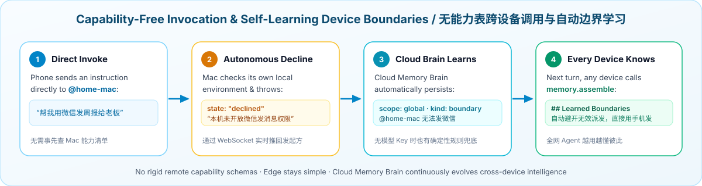
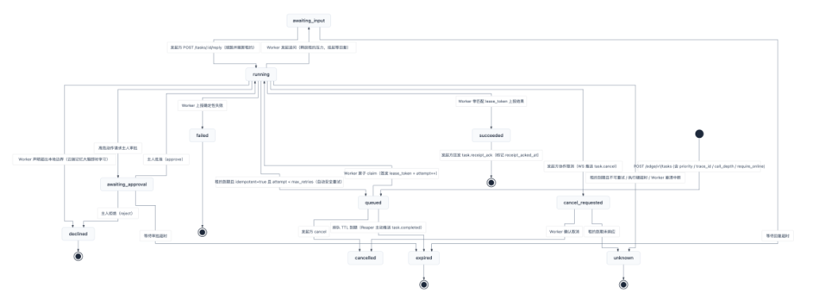

<p align="center">
  
</p>

<h1 align="center">AnyLink Agent</h1>

<p align="center">
  <strong>你的个人 Agent 网络：把记忆与模型留在云端大脑，让执行自由分布在每一台设备。</strong>
</p>

<p align="center">
  <a href="README.md"></a>
  <a href="protocol/README.zh-CN.md"></a>
  <a href="https://github.com/windowssr/AnyLink-Agent/releases/tag/v0.9.0"></a>
  <a href="sdk-python/README.md"></a>
  <a href="sdk/README.zh-CN.md"></a>
  <a href="mcp/README.md"></a>
  <a href="LICENSE"></a>
</p>

<p align="center">
  <a href="#为什么做-anylink">设计理念</a> ·
  <a href="#整体架构">整体架构</a> ·
  <a href="#10-行代码接入你的设备">快速接入</a> ·
  <a href="#蓝色大肥鱼参考客户端">蓝色大肥鱼展示</a> ·
  <a href="#自部署云端中枢">自部署</a> ·
  <a href="protocol/README.zh-CN.md">Protocol v3 规范</a>
</p>

---

## 为什么做 AnyLink？

今天大多数 AI Agent 都被困在单台设备里：电脑上的 Agent 不知道你手机上刚聊过什么，服务器上的脚本和桌面工具各自维护孤立的上下文，跨设备协作还要写一堆脆弱的能力注册表和轮询胶水。

**AnyLink 提出一种全新的个人 Agent 网络架构 —— 「云端记忆大脑 + 边缘设备自治」：**

| 维度 | 传统单机 / 云端强控 Agent | **AnyLink Protocol v3** |
| --- | --- | --- |
| **记忆归属** | 分散在各设备本地文件，换台设备就失忆 | **云端记忆大脑统一管理**：混合分词+向量检索、去抖批整理、自动去重合并，跨设备天然共享 |
| **模型 API** | 每台设备单独填 Key、换模型逐台改配置 | **云端多模型网关**：Key 永不离开服务器、支持多模型别名与可选自动记忆模式（`X-AnyLink-Auto-Memory: on`） |
| **跨设备调用** | 先查死板的能力表、短轮询延迟高、断线任务永久卡死 | **WebSocket 实时总线 + 无能力表直调**：用 `@home-mac` 唯一短别名直接发指令，自带租约心跳防卡死 |
| **能力边界演进** | 手动维护 JSON Schema，改一点全网失效 | **自学习设备边界**：对方做不到直接返回 `declined`，云端自动记成全局边界，全网 Agent 越用越懂彼此 |
| **生态接入** | 绑定某个特定框架 | **引擎无关开源协议**：提供 **Python SDK (PyPI)**、**TypeScript SDK (npm)** 与 **零代码 MCP 适配器** |

<p align="center">
  
</p>

---

## 整体架构

<p align="center">
  
</p>

### 亮点机制：边缘只管自己，云端大脑越用越聪明

每台边缘设备**不需要关心其他设备有什么能力**，只需要管好自己所在的本地环境和安全策略：

<p align="center">
  
</p>

- **快捷登录密码（`ANYLINK_LOGIN_PASSWORD`）**：面向普通用户，服务端可选配置一个好记的预设密码（至少 6 位）；在手机端、电脑端或 Web 管理后台直接输入服务器地址和该密码即可一键连接，云端自动签发高熵加密设备令牌（密码不落盘）。
- **唯一短别名（`device_slug`）**：即使你有两台同名的 Mac，也能用 `@home-mac`、`@office-mac` 精确寻址；同名歧义自动返回 `409 AMBIGUOUS_TARGET_DEVICE` 并提示候选别名。
- **去抖动 + 闲聊过滤 + 崩溃恢复**：连续对话按会话窗口（默认 15 秒 / 6 轮）合并为**单次**云端记忆整理调用，短闲聊（“好的 / 你好 / 嗯”）直接跳过 0 消耗；跨设备拒绝/失败边界立即落盘学习，服务端重启自动恢复待处理批次并按 Owner 串行化防止竞态。

### Protocol v3.2 任务状态机与弱网 / 多 Agent 可靠性架构

面向真实公网、Wi-Fi/4G 切换、笔记本休眠与多 Agent 协作场景，Protocol v3.2 补齐了端到端网络韧性与协作原语：

<p align="center">
  
</p>

- **弱网加固的 WebSocket 实时总线**：应用层双向心跳与僵尸连接剔除、慢消费者背压保护、单调递增 `edge_events` 事件序列游标（`resume_after_seq` 断线续传零丢帧），以及回执送达确认（`task.receipt_ack` / `POST /edge/v1/tasks/:id/ack`），未确认的跨设备回执在重连后自动补发。
- **防脑裂 Fencing Token 与可靠超时回报**：每次原子 `claim` 签发递增 `attempt` 与随机 `lease_token`，失联复活的旧 Worker 回传会被 `409 LEASE_FENCED` 拦截；声明 `idempotent: true` 的只读任务租约超时可自动安全重试，带副作用任务绝不盲目重跑；统一 Reaper 主动推送排队过期（`expired`）、等待追问/审批超时与硬执行超时（`max_execution_seconds`）。
- **队列治理与循环调用防护**：支持任务优先级 `priority`（0–100）、要求在线快速失败 `require_online`（`409 TARGET_OFFLINE`）、资源级并发互斥键 `concurrency_key`、队列水位限流（`429 QUEUE_FULL`），以及 `trace_id` / `parent_task_id` / `call_depth` 防无限互相调用（`409 CALL_DEPTH_EXCEEDED`）。
- **人机协同挂起与大附件流式直传**：Worker 可通过 `/suspend` 挂起为 `awaiting_input`（追问）或 `awaiting_approval`（高危审批）并暂停租约扣减，主人回复 `/reply` 后无缝恢复；视频、文档、压缩包等大文件通过 `POST/GET /edge/v1/artifacts` 零内存流式直传与独立磁盘卷存储（SHA-256 校验、默认单文件 200 MiB / 总配额 2 GiB，可调至 1 GiB、到期自动清理）。
- **SSE 断线脱钩续接与离线 Outbox**：对话流携带 `X-AnyLink-Detach-On-Disconnect: on` 后，即使手机切网断开，云端也会继续跑完生成并缓存快照，重连通过 `GET /model/v1/requests/:id` 补拉完整结果；离线产生的记忆先入本地 Outbox 队列，恢复联网自动补发。

---

## 10 行代码接入你的设备

### 方式一：Python SDK（PyPI `anylink-agent`）—— 适合 Linux 服务器 / 脚本 / LangGraph / CrewAI

```bash
pip install anylink-agent   # 或本地源码安装：uv pip install -e ./sdk-python
```

```python
import asyncio, os
from anylink import AnyLinkAgent, AnyLinkClient, TaskContext, TaskDeclined

async def main():
    joined = await AnyLinkClient.connect(
        base_url=os.environ["ANYLINK_BASE_URL"], join_key=os.environ["ANYLINK_JOIN_KEY"],
        install_id="gpu-server-01", device_name="GPU 服务器", device_slug="gpu-box",
        platform="linux", agent_key="worker", agent_name="GPU Agent",
    )
    async with AnyLinkClient(os.environ["ANYLINK_BASE_URL"], joined["token"]) as client:
        # 1. 拉取跨设备共享记忆与设备边界
        mem = await client.assemble_memory(query="最近在跑哪个训练任务？")
        # 2. 调云端多模型网关（可选开启自动共享记忆）
        reply = await client.chat_completions(model="default", messages=[{"role": "user", "content": "总结进度"}], auto_memory=True)
        # 3. WebSocket 实时接单：只需管好本机环境，做不到直接 TaskDeclined
        agent = AnyLinkAgent(client, journal_path="./private-state/journal.jsonl")

        @agent.on_invoke
        async def handle(task: dict, ctx: TaskContext):
            if "微信" in (task.get("instruction") or ""):
                raise TaskDeclined("UNSUPPORTED", "Linux 服务器没有微信")
            await ctx.report_progress(stage="working", message="检查 GPU 状态中", percent=50)
            return {"reply": f"已完成：{task['instruction']}"}

        await agent.run()

asyncio.run(main())
```

### 方式二：TypeScript SDK（npm `@anylink-agent/sdk`）—— 零第三方依赖，Node >= 22

```js
import { AnyLinkClient } from '@anylink-agent/sdk';
import { AnyLinkWorker, TaskDeclined } from '@anylink-agent/sdk/worker';

const joined = await AnyLinkClient.connect({
  baseUrl: process.env.ANYLINK_BASE_URL, joinKey: process.env.ANYLINK_JOIN_KEY,
  installId: 'home-mac-01',
  device: { name: 'MacBook Pro', slug: 'home-mac', platform: 'macos' },
  agent: { key: 'desktop', name: 'Mac Agent' },
});
const client = new AnyLinkClient({ baseUrl: process.env.ANYLINK_BASE_URL, token: joined.token });

// 直接按唯一短别名向另一台设备发任务并实时等待完成
const task = await client.invoke({ target: { device_slug: 'gpu-box' }, instruction: '查看当前显存占用' });
const done = await client.waitForTask(task.id);
```

### 方式三：零代码接入 Claude Code / Cursor / Codex（MCP Server）

把 [mcp/bin/anylink-mcp.mjs](mcp/bin/anylink-mcp.mjs) 配进你的 MCP 客户端，立刻获得云端共享记忆检索/沉淀与跨设备调用能力：

```json
{
  "mcpServers": {
    "anylink": {
      "command": "node",
      "args": ["/path/to/anylink-agent/mcp/bin/anylink-mcp.mjs"],
      "env": {
        "ANYLINK_BASE_URL": "https://your-anylink-server.example",
        "ANYLINK_TOKEN": "ak_..."
      }
    }
  }
}
```

---

## 蓝色大肥鱼参考客户端（隔离于 `examples/`）

AnyLink 的核心价值是**中立、通用的个人 Agent 互联协议（Protocol v3）与云端中枢/SDK**。为了方便直接体验，仓库在 [`examples/`](examples/README.md) 目录下额外隔离提供了两款以深海蓝白鲸鱼娘「大肥鱼」为交互卖点的完整展示客户端（核心协议层与角色完全解耦，二次开发可完全不引入 `examples/`）：

1. **电脑端（Mac + OpenClaw 后台常驻 Agent）** — 详见配置文档：[`examples/mac-openclaw/README.md`](examples/mac-openclaw/README.md)
   - 基于 OpenClaw + Protocol v3.2 插件与并发 WebSocket Worker（`maxConcurrency=2`），支持直连公网 HTTPS（无需常驻 SSH 隧道），由 macOS LaunchAgent 后台常驻运行，支持云端记忆同步、`anylink_invoke` / `anylink_task_reply`、**跨设备双向大文件互传**（`anylink_file_send` / `file.deliver`，默认保存至 `~/Downloads/AnyLink/`）、默认白名单安全沙箱或 `--full-access` 全权限模式（启动时自动清理历史 `OUTSIDE_ROOT` 陈旧边界记忆）、可选桌面 Live2D 桌宠与本地语音。
2. **手机端（Android 原生独立 Agent）** — 详见配置文档：[`examples/android-native/README.md`](examples/android-native/README.md)
   - 手机本地运行完整对话循环与 SQLite 幂等账本，**不依赖 Mac 在线**；v0.9.0 全新「深海玻璃陪伴」视觉设计：全屏无遮挡 Live2D 舞台（内置 WebGL 像素实测验证，根治闪现消失）+ 陪伴/阅读双视图切换 + 磨砂玻璃完整对话流 + v3.2 高危审批/追问交互卡片 + 预设密码一键登录 + 后台前台服务保活、悬浮球与高优先级主动消息弹窗通知 + **📎 一键/指令跨设备双向传文件（200 MiB 流式读写、收件卡片一键打开/分享）** + **手机 Agent 默认 100 步执行上限（可在「保活」设置页切换 `50 / 100 / 200 / 不限`，含循环内自动裁剪旧屏幕与一键「继续执行」）** + 离线 Outbox / SSE 断线续接 + 贴合「蓝色大肥鱼」人设的活泼语音播报。

### 跨设备双向文件互传与上传上限配置

边缘设备之间通过云端临时附件中转（`/edge/v1/artifacts`）+ `file.deliver` 跨设备任务实现**全链路 O(1) 内存流式传输**（边传边算 SHA-256 校验，云端独立磁盘卷落盘，到期自动清理）：

- **手机 → 电脑**：在 Android 对话框左下角点 `📎` 选文件（支持文档、图片、音视频、压缩包等）；**留空附言点「发文件」**直接零延迟传给在线 Mac 并保存到 `~/Downloads/AnyLink/`；也可**附加文字指令**（如"帮我整理这份 PDF 的重点"），手机上传后自动带 `artifact_id` 派发给电脑处理。
- **电脑 → 手机**：在 Mac 或手机对话中直接让大肥鱼发送本机文件（如"把桌面的周报发到我手机"），Mac 调用 `anylink_file_send` 流式上传并派发 `file.deliver`；手机端自动流式写入 `下载/AnyLink/`，弹出顶部横幅通知并在聊天流生成带「打开文件 / 分享」按钮的文件卡片。
- **SDK / 服务器脚本节点**：使用 `@anylink-agent/sdk` 的 `client.uploadArtifact(...)` / `client.downloadArtifactToFile(...)` 或直接调用 `POST/GET /edge/v1/artifacts` 流式二进制接口。

#### 上传上限与配额在哪里修改？

| 位置 | 配置项 | 默认值 | 可调范围 / 说明 |
| :--- | :--- | :--- | :--- |
| **云端服务端**（本地 `.env` 或服务器 `/opt/anylink-agent/secrets/app.env`） | `ANYLINK_ARTIFACT_MAX_BYTES` | `209715200`（**200 MiB**） | 单文件上传上限，最高支持 `1073741824`（**1 GiB**） |
| **云端服务端**（同上） | `ANYLINK_ARTIFACT_QUOTA_BYTES` | `2147483648`（**2 GiB**） | 单 Owner 未过期附件总配额，最高支持 `21474836480`（**20 GiB**） |
| **云端服务端**（同上） | `ANYLINK_ARTIFACT_TTL_SECONDS` | `3600`（1 小时） | 临时附件保留时长（`60`–`86400` 秒），过期自动删除磁盘文件 |
| **云端服务端**（`deploy/compose.yaml`） | `ANYLINK_ARTIFACT_DIR` | `/data/artifacts` | 容器内附件落盘目录（生产环境默认挂载宿主机 `/opt/anylink-agent/data/artifacts`） |
| **云端服务端**（可选，同上 `app.env`） | `ANYLINK_MAX_AGENT_RPM` | `60` | 单 Agent 每分钟模型请求限速（最高 `600`），重度多步控屏时可按需调大 |
| **Mac 端客户端安全阀** | `MAX_ARTIFACT_BYTES` | `200 MiB` | 若服务端调大超过 200 MiB，同步修改 [`examples/mac-openclaw/plugin/index.mjs`](examples/mac-openclaw/plugin/index.mjs) |
| **Android 端客户端安全阀** | `AnyLinkFiles.MAX_BYTES` | `200 MiB` | 若服务端调大超过 200 MiB，同步修改 [`examples/android-native/overlay/.../AnyLinkFiles.kt`](examples/android-native/overlay/app/src/main/java/ai/openclaw/app/anylink/AnyLinkFiles.kt) 并重新打包 APK |

> 修改服务器 `/opt/anylink-agent/secrets/app.env` 后重启容器生效（例如 `docker compose -f /opt/anylink-agent/current/compose.yaml --env-file /opt/anylink-agent/current/release.env up -d --force-recreate app`）；如前面有自定义 Nginx 反向代理，请同时确保 `client_max_body_size` 不小于该值（项目内置的 Caddy 网关默认不设体积上限）。

### Mac 端常用控制小技巧

- **看实时后台日志**：`tail -f data/mac/logs/service.log`
- **电脑端打开对话界面**：浏览器访问 `http://127.0.0.1:18791/openclaw/`
- **查看云端管理后台**（记忆大脑、跨设备任务记录、设备在线状态）：浏览器访问 `http://127.0.0.1:3181/`（使用预设登录密码 `ANYLINK_LOGIN_PASSWORD` 或 `OWNER_TOKEN` 登录）
- **临时暂停 / 恢复后台服务**：
  - 暂停：`launchctl bootout gui/$(id -u) ~/Library/LaunchAgents/com.anylink.openclaw.plist`
  - 恢复：`launchctl bootstrap gui/$(id -u) ~/Library/LaunchAgents/com.anylink.openclaw.plist`
  - 重启：`launchctl kickstart -k gui/$(id -u)/com.anylink.openclaw`

### 区分项目里的密钥与登录密码（避免填混）

| 密钥 / 密码 | 存放位置 | 用途 |
| :--- | :--- | :--- |
| **登录密码（推荐，可选）** | 服务器 `app.env` / `.env` (`ANYLINK_LOGIN_PASSWORD`，≥6 位) | **普通用户最简方式**：手机端、电脑端一键接入，以及登录云端管理后台 `127.0.0.1:3181/` |
| **Gateway Token** | 本地 `secrets/mac-gateway-token` | 登录本机电脑端 OpenClaw 网页 `127.0.0.1:18791/openclaw/` |
| **Owner Token** | 服务器 `/opt/anylink-agent/secrets/app.env` (`OWNER_TOKEN`) | 登录云端管理后台 `127.0.0.1:3181/`（管理员长随机令牌） |
| **Join Key** | 本地 `secrets/ywc-join-key`（同服务器 `ANYLINK_JOIN_KEY`） | 手机、其他电脑或 SDK 接入云端网络时的长随机「加入密钥」 |
| **Device Token (`ak_...`)** | 本地 `secrets/mac-connection.json` / 手机 Keystore 加密库 | 单个设备 Agent 自动认证云端用，连接成功后自动签发保存，平时无需手动填写 |

<p align="center">
  
  
</p>

<p align="center">
  <sub>左：公开版原创占位形象；右：本地自行配置第三方角色预览（两图均为桌面浏览器构图预览，非真机截图）。<br/>
  公开仓库与发布包<strong>不包含</strong>第三方 Live2D 模型、纹理与 Cubism Core；DeepSeek-chan 原画/拆分：神宫凉子，Live2D：霓虹猫_NeonNeko，详见 <a href="THIRD_PARTY_NOTICES.md">THIRD_PARTY_NOTICES.md</a>。</sub>
</p>

---

## 自部署云端中枢

环境要求：Node 22+、npm、Docker Compose（PostgreSQL 16/17 标准镜像即可，无需强制扩展）。

```bash
git clone https://github.com/windowssr/AnyLink-Agent.git
cd AnyLink-Agent
npm ci
node scripts/init-local.mjs
# 可选：在 .env 中配置 DEEPSEEK_API_KEY 或 ANYLINK_MODELS_JSON 多模型路由（切勿提交 .env）
docker compose --env-file .env -f deploy/compose.local.yaml up -d --wait
npm run build
node --env-file=.env dist/server/index.js
```

浏览器访问 `http://127.0.0.1:3180`，使用 `secrets/local-dev-owner-token` 登录管理台查看共享记忆、跨设备动态、在线设备（含 `WS 实时在线` 状态）与模型用量。公网 HTTPS 部署与备份回滚脚本见 [docs/open-source/self-hosting.md](docs/open-source/self-hosting.md)。

---

## 仓库结构与路线图

```text
├── protocol/           # 核心：Protocol v3 规范文档与自动生成的 OpenAPI 3.1 契约
├── server/             # 核心：云端中枢（记忆大脑 + 多模型网关 + WebSocket 实时总线 + 管理台 API）
├── sdk/                # 核心：@anylink-agent/sdk — 零依赖 TypeScript/JS SDK (npm)
├── sdk-python/         # 核心：anylink-agent — Python 异步 SDK 与装饰器边缘节点 (PyPI)
├── mcp/                # 核心：@anylink-agent/mcp — Claude Code / Cursor / Codex MCP 适配器
├── web/                # 核心：云端管理后台（React + Vite）
└── examples/           # 隔离的配套展示实例（与核心协议零耦合）
    ├── mac-openclaw/   # 参考展示：Mac OpenClaw 后台 Agent、文件/全权限工具与桌面伴侣（含独立 README）
    ├── android-native/ # 参考展示：Android 原生大肥鱼客户端、独立对话流与后台保活（含独立 README）
    └── persona/        # 可选共享人设模板（核心协议完全中立）
```

- [x] **第一阶段**：Protocol v3.0 规范、云端记忆大脑（混合检索 + 去抖批整理 + 边界自动学习）、多模型网关与 1A 自动记忆、WebSocket 实时总线与租约回收、设备唯一短别名 `slug`、Python SDK、TypeScript SDK、MCP Server。
- [x] **第二阶段**：Mac OpenClaw 插件与 Worker 及 Android 原生大肥鱼客户端全面迁移至 Protocol v3，完成 `examples/` 彻底隔离与预设密码快捷接入。
- [x] **第三阶段（`v0.9.0` / Protocol v3.2）**：弱网与多 Agent 全链路可靠性升级——WS 僵尸连接剔除、事件序列游标续传、回执送达 ACK、Fencing Token 防脑裂、队列治理与递归深度防护、人机协同挂起（`awaiting_input` / `awaiting_approval`）、二进制大附件直传、SSE 断线脱钩续接、离线 Outbox、Mac 全权限陈旧边界自愈、Android 深海玻璃重设计与 Live2D 渲染根因修复，以及贴合「蓝色大肥鱼」人设的语音播报。
- [ ] **第四阶段**：正式发布 `anylink-agent` 至 PyPI、发布 `@anylink-agent/sdk` 与 `@anylink-agent/mcp` 至 npm，以及更多生态框架适配器（LangGraph / CrewAI / AutoGen）。

---

## 开源与安全

- 本项目原创代码与文档采用 [MIT License](LICENSE)，详见 [SECURITY.md](SECURITY.md) 与 [CONTRIBUTING.md](CONTRIBUTING.md)。
- 代码同步托管于 [GitHub](https://github.com/windowssr/AnyLink-Agent) 与 [Gitee](https://gitee.com/windowssr/anylink-agent)。如果这套「云端记忆大脑 + 边缘自治」的个人 Agent 网络思路对你有启发，欢迎点个 **Star** 或提交适配器 PR！
