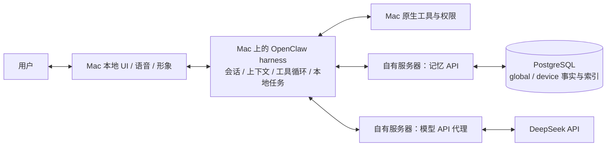

# 整体架构与模块边界

## 当前目标通路

Android 后续采用同样的边界：交互与 Agent 在 Android，访问相同的模型与记忆服务。不能只因官方有 Android companion 就认定它已提供完整本地 harness。

## Mac 所有权

- 接收用户输入，决定响应、取消和任务状态。
- 持有本地会话，组装人格、历史、记忆与工具结果。
- 管理成熟 harness 的工具循环，执行文件、进程、应用等已授权操作。
- 管理本地任务、步骤与回执；重启后先对账，不重复副作用。
- 处理语音播放、形象状态、系统权限和主动交流策略。

## 服务器所有权

- global / device 事实、来源、revision、删除与索引。
- 模型提供商凭据、模型请求转发、限流、费用与超时。
- 访问这两项服务所需的主人 / 设备身份、撤销与审计。

服务器不持有正在和用户对话的 Agent，不组装产品系统提示，不运行用户任务工具循环，不领取和派发设备步骤，也不决定用户此刻听见哪段话。

## 模型代理必须是模型接口

边缘 harness 调用 OpenAI-compatible 模型 API，服务器直连 DeepSeek 并透传消息、工具 schema、`tool_calls`、工具结果、SSE 和用量。它不执行传入的工具，不消费工具调用再另开一轮 Agent。

现有云端 OpenClaw `/v1/chat/completions` 是 Agent 入口，不应充当该模型代理。把本地 OpenClaw 接到它会嵌套两个 Agent 运行时，重新混淆会话、工具与错误归属。

## 权威数据

长期事实权威在云端记忆库；活跃会话、运行与步骤权威在对应设备的 harness / 本地账本。云端可保存用户选择同步的结果摘要、会话备份或设备目录，它们是存储对象，不能反向成为执行调度权威。

统一记忆不要求统一 Agent 进程。模型在远端推理也不要求工具循环在服务器。
