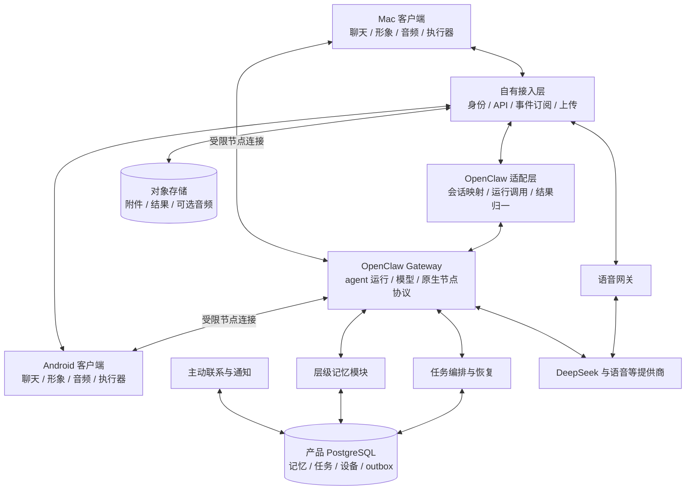

# 整体架构与模块边界

## 1. 总体结构

图中是职责边界，第一版不要求每个框都是独立进程。自有 API、记忆、任务和通知可先做成一个模块化服务，配合一个 Gateway、一个 worker 和一个数据库运行。

## 2. 权威数据归属

| 数据 | 权威所有者 | 其他模块如何访问 |
| --- | --- | --- |
| 用户、逻辑设备、设备绑定 | 产品接入层 / 设备模块 | 经内部接口读取，不能信任客户端自行填写 owner |
| 对话历史、agent run | OpenClaw | 产品维护映射和必要读模型，不建立另一套可独立修改的聊天历史 |
| 人格配置版本 | 产品人格模块 | 由适配层下发到单一主人格 agent 的配置与上下文 |
| 长期事实和设备索引 | 产品记忆模块 | 插件、管理 API、上下文组装器共用同一服务 |
| 任务和设备步骤状态 | 产品任务账本 | Workboard 是展示 / 会话关联投影，不能反向覆盖真实步骤结果 |
| 设备执行回执 | 设备本地日志 + 云端接收记录 | 断线后按步骤查询并对账 |
| 主动消息投递状态 | 通知模块 | outbox 驱动，客户端读取游标同步 |
| 字幕、音频时间轴、表情 | 当前响应 / 语音模块 | 客户端按响应 ID 和播放代次消费 |

## 3. OpenClaw 的位置

OpenClaw 负责模型运行、工具循环、会话与节点通信。自有适配层把产品身份和会话映射到 Gateway，不再建立第二套互相竞争的 agent 主循环。

产品服务调用自己实现的 Gateway 插件入口；入口和具体 SDK 调用方式需要版本原型验证。外部客户端不会持有 Gateway 管理员令牌。节点可以直连受限 Gateway 入口，使用各自的节点凭据；聊天侧统一经过产品接入层。

产品身份传入 Gateway 必须是可信服务签发并由适配器校验的内部上下文。通过接入层转发后，原始设备签名身份不能凭空保留；不能把公网请求里的 `device_id` 当成 OpenClaw 已验签的 `requesterDeviceId`。具体绑定见 [集成与改造](16-OpenClaw集成与改造.md)。

## 4. 云端模块

- 接入层：认证、设备绑定、请求幂等、附件、事件订阅和统一错误。
- 会话 / 人格编排：确定本次会话、人格版本、目标设备和上下文预算。
- 记忆：事实修订、索引、检索、可见范围和遗忘。
- 任务：规划转任务、调度、执行授权、步骤和结果对账。
- 模型网关：模型路由、流式输出、超时、预算和提供商适配。
- 语音：流式音频、ASR / TTS 或实时模型、打断和声音焦点。
- 通知：主动交流策略、触达设备选择、投递和去重。
- 运维：日志、指标、备份和版本升级。

## 5. 设备侧模块

客户端 UI、形象渲染、麦克风 / 播放器、节点连接、本地权限、执行器、本地回执与同步缓存分开。界面崩溃不应该自动重复执行已接受的任务；执行器退出不应该把云端事实删掉。

设计默认沿用或改造 OpenClaw 原生客户端的节点能力，在原生外壳中接入共享 Web 形象层。能否直接复用全部节点实现需要实际构建验证；Mac 和 Android 不假设共享同一套系统操作代码。

## 6. 存储与运行选择

产品数据默认使用 PostgreSQL；向量检索可使用 pgvector 适配器，全文检索和结构化过滤并用。OpenClaw 内部存储保持官方支持的引擎，由 Gateway 自己管理，不跨进程直接改其表。

Redis 不是第一版必需组件；可后续用于临时缓存、限流和在线扇出，但任务、长期事实和需要恢复的事件不能只放 Redis 或进程内存。附件使用对象存储接口，单机开发可用受控文件目录适配。

## 7. 关键边界

所有新增 API 都是产品协议；所有 OpenClaw 调用经过一个版本适配模块。设备能力和执行授权来自宿主与当前配对，模型只提出意图。每个副作用必须经过任务步骤账本，不能一边走可靠执行器，一边允许模型绕过它直接调用同类原生写操作。
