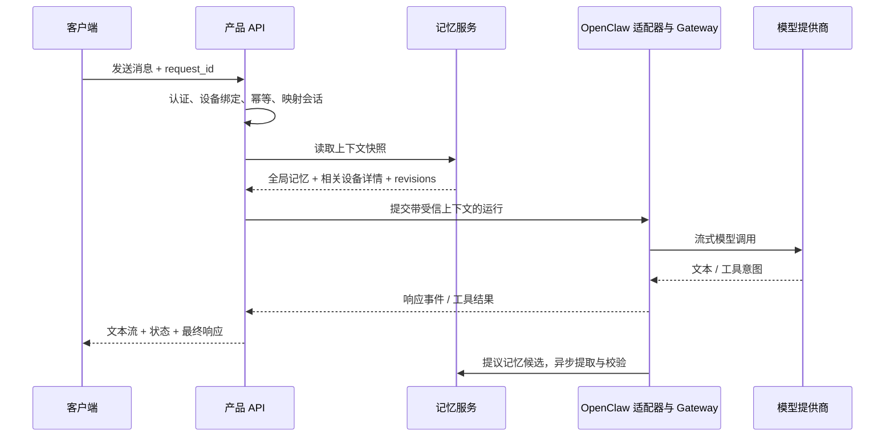
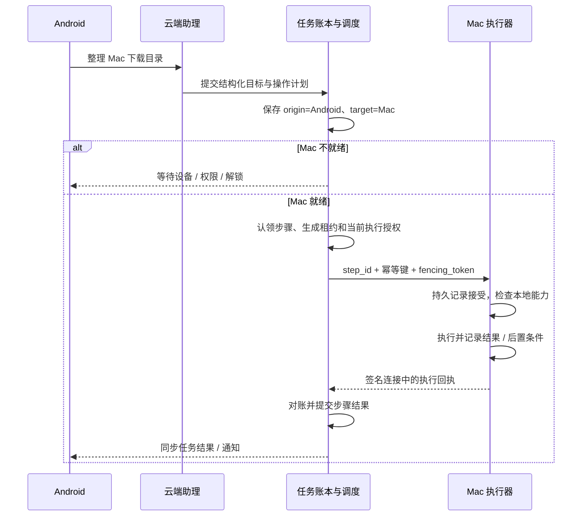

# 端到端通路与时序

## 1. 一次文字对话

`request_id` 在客户端重试时保持不变。服务端只有拿到 Gateway 的持久接受证据，或已写入自己的可恢复提交记录后，才能显示“已发送”。提交结果未知时先查询，不把一次聊天变成两次模型运行或两个任务。

## 2. 新事实写入与全局索引更新

1. 从已记录的消息或设备结果提出候选，附来源事件和适用范围。
2. 记忆服务检查是否重复、是否与现有事实冲突、是否有足够证据。
3. 同一数据库事务保存修订和 outbox 事件，更新可直接读取的当前版本。
4. worker 更新向量 / 全文索引、设备摘要和全局目录，记录所依据的 revision。
5. 推送 `memory.changed`，客户端和语音上下文标记失效。
6. 下一次召回若发现摘要落后，直接读取事实，或暂时略过落后摘要。

用户明确更正的事实优先于模型推断。索引后台失败不能回滚已确认的事实，也不能让旧索引覆盖新事实。

## 3. Android 发起 Mac 执行

模型规划结束不代表任务完成。每个写操作在发出前就必须有步骤记录。任务等待期间不要把一次模型运行或临时授权令牌长时间挂住；重新调度时重新建立符合当前规则的执行上下文。

## 4. 操作已经完成，但连接断开

设备在本地保存最终回执。云端超时后将步骤置为 `needs_reconciliation`，不会把它当普通失败立即重试。重连后先查该步骤回执；查不到时检查文件、应用或业务后置条件。

若无法确认结果，向用户呈现可理解的待处理状态。对于发送消息、付款、删除等不可安全重复的动作，不能把“没收到结果”当成“没有执行”。详见 [任务设计](07-任务调度与可靠执行.md)。

## 5. 语音交流

设备本地 VAD / 音频采集 → 服务器流式 ASR → 同一会话与记忆组装 → OpenClaw 模型流 → 流式 TTS → 设备播放与口型。

实时语音模型是后续替代路径，不能同时让文字 agent 和语音模型分别回答同一轮。每轮有唯一响应所有者，语音里的工具意图进入同一任务账本，记忆使用同一版本。打断只先停止旧播放，任务取消走独立命令。

## 6. 主动联系

任务完成 / 用户设定提醒 / 授权的目标跟进事件 → 主动联系策略 → 持久化 interaction → 选择主触达设备 → 创建 notification outbox → 实际投递 → 回执与去重。

如果没有适合播放声音的在线设备，降级为通知或会话未读，不在所有设备同时开口。详情见 [主动联系与通知](13-主动联系与通知.md)。

## 7. 设备切换和恢复

客户端保存自己的事件消费游标。重连时先获取实体快照，再补齐快照 watermark 之后的事件；过期游标返回“需要重新同步”，不能伪装成没有新事件。

共享聊天可以在多个设备查看；麦克风 / 声音焦点与设备执行租约各自独立。拿到语音焦点不会自动获得另一台设备的执行授权。更换设备目标产生新的计划或明确的修订，不改变已经执行的步骤归属。
