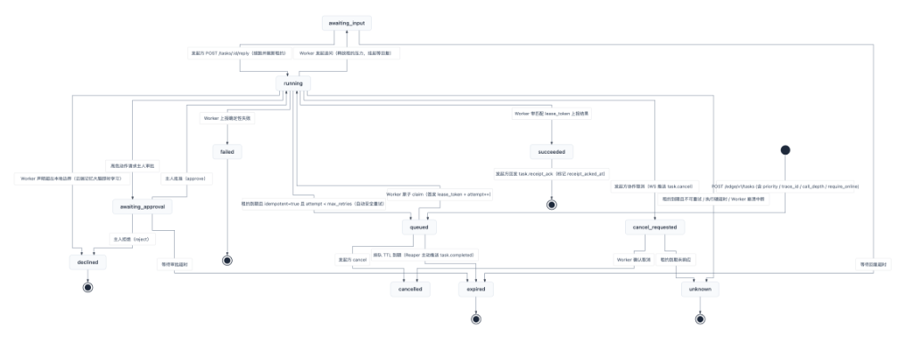

# AnyLink Protocol v3 (`3.2`)

[简体中文](README.zh-CN.md) · [OpenAPI 3.1](openapi.json) · [TypeScript SDK](../sdk/README.md) · [Python SDK](../sdk-python/README.md) · [MCP Adapter](../mcp/README.md)

AnyLink is a harness-independent protocol for a **Personal Agent Network**:

- **Edge autonomy**: Each device (macOS, Linux, Windows, Android, servers, scripts) runs its own Agent and manages only its own local environment and security policy.
- **Cloud-centric Model Gateway**: Multi-model OpenAI-compatible passthrough with optional automatic shared-memory injection (`X-AnyLink-Auto-Memory: on`) and **detached SSE resume** (`X-AnyLink-Detach-On-Disconnect: on` + `GET /model/v1/requests/:id`).
- **Cloud Memory Brain**: Unified, cross-device memory managed by a cloud Memory Agent — hybrid CJK/Latin + optional vector retrieval (`POST /edge/v1/memory/assemble`), asynchronous turn/task ingestion (`POST /edge/v1/memory/ingest`) with startup recovery & per-owner serialization, deduplication, conflict consolidation, and automatic **capability boundary learning**.
- **Capability-free cross-device invocation**: Edge agents do not need to inspect rigid capability schemas of remote devices. Send an intent/task directly to a target agent or device; if the receiver cannot execute it, the receiver replies `declined` (or `failed`) with the reason, and the Cloud Memory Brain records that boundary so future turns naturally avoid invalid requests.
- **Resilient WebSocket Bus (`GET /edge/v1/ws`)**: Instant task dispatch, monotonic `edge_events` sequence cursor (`resume_after_seq`), receipt delivery ACKs (`task.receipt_ack`), ping/pong zombie eviction, slow-consumer backpressure protection, Fencing Token (`attempt` + `lease_token`) split-brain guard, interactive `awaiting_input` / `awaiting_approval` suspend/reply, and binary artifacts (`/edge/v1/artifacts`) — with full HTTP fallback.

## Task Lifecycle State Machine (`3.2`)

<p align="center">
  
</p>

## 1. Identity & Connection

Identity hierarchy: `Owner → Device → Agent`.

1. **Join (`POST /edge/v1/connect`)**: Authenticate with `Authorization: Bearer <ANYLINK_JOIN_KEY>` (or optional `ANYLINK_LOGIN_PASSWORD`), supply `device: { install_id, name, platform, slug? }` and `agent: { key, name, kind?, summary? }`. `slug` is a unique short alias (e.g. `home-mac`, `gpu-box`; auto-generated if omitted) to disambiguate devices with identical display names. Returns `201` with `device_id`, `device_slug`, `agent_id`, `credential_id`, one-time `token` (`ak_...`), and `protocol: { name: "anylink", version: "3.2" }`.
2. **Protocol negotiation (`GET /edge/v1/protocol`, alias `GET /edge/v1/link/protocol`)**: Returns version `3.2`, transport URLs, v3.2 feature flags, lease-backed delivery semantics, and routing modes (`agent`, `device`, `device_slug`, `device_name`, `agent_key`, `any`).
3. **Profile (`PATCH /edge/v1/agent/profile`, `PATCH /edge/v1/device/profile`)**: Update informational agent summary or device name / unique `slug`. Informational only; never blocks incoming tasks.

## 2. Cloud Memory Brain

### Scopes & Kinds
- **Scopes**: `global` (shared across all devices), `device` (scoped to one device; only that device or Owner may mutate it), `agent` (private to one agent).
- **Kinds**: `fact`, `preference`, `boundary` (learned limits of what a device/agent can or cannot do), `episode`.

### Endpoints
- **`POST /edge/v1/memory/assemble`**: Given `{ query?, max_memories?, max_episodes?, max_chars?, include_scopes?, include_boundaries?, include_persona? }`, returns ranked `memories`, recent cross-device `episodes`, cross-device `boundaries`, and a ready-to-inject `summary_text`.
- **`POST /edge/v1/memory/ingest`**: Submit `{ kind: "turn" | "task_outcome" | "observation", session_key?, messages, metadata?, consolidate_now? }`. Automatically skips trivial short chitchat (0 LLM tokens), debounces & batches burst turns per session (`ANYLINK_MEMORY_DEBOUNCE_MS=15000`, `ANYLINK_MEMORY_BATCH_MAX=6`) into a single Cloud Memory Agent LLM call, and immediately consolidates declined/failed task outcomes so device boundaries are learned without delay.
- **`GET /edge/v1/memory/episodes`**: List recent cross-device episodes.
- **`GET /edge/v1/context`**: Snapshot returning `global`, `device`, `agent` memories, `boundaries`, `episodes`, and optional `persona`.
- **Explicit CRUD**: `POST /edge/v1/memories`, `POST /edge/v1/memories/search`, `GET /edge/v1/memories/:id`, `PATCH /edge/v1/memories/:id` (CAS via `expected_revision`), `DELETE /edge/v1/memories/:id` (CAS via `If-Match`).

## 3. Multi-Model Gateway

- **`GET /model/v1/models`**: Lists configured models and aliases (`default`, provider models, etc.).
- **`POST /model/v1/chat/completions`**: OpenAI-compatible JSON & SSE streaming passthrough supporting multiple configured models/providers and per-agent concurrency limits.
  - **Optional Auto-Memory Mode**: Pass `X-AnyLink-Auto-Memory: on` (or enable `ANYLINK_AUTO_MEMORY_DEFAULT=true` on the server) to automatically assemble relevant shared memory into the request context and ingest the completed turn into the Cloud Memory Brain in the background.
  - **Detached SSE Resume (`3.2`)**: Pass `X-AnyLink-Detach-On-Disconnect: on` to receive `X-AnyLink-Request-Id` in the response header. If the client connection drops mid-stream, the hub finishes reading upstream, persists `response_snapshot`, and lets the client recover the full result via **`GET /model/v1/requests/:id`** (15-minute retention).
- **`POST /model/v1/speech`**: Optional TTS endpoint supporting `style` (`neutral` | `persona`), `rewrite` (`auto` | `always` | `never`), `voice`, `rate`, and `pitch`.

## 4. Cross-Device Invocation, Interactive Suspend & WebSocket Bus (`3.2`)

### Task States
`queued` → `running` (with `attempt`, `lease_token`, `lease_expires_at`, optional `max_execution_seconds`) ⇄ `awaiting_input` | `awaiting_approval` → `succeeded` | `failed` | `declined` | `cancelled` | `unknown` | `expired` (plus `cancel_requested` during cooperative cancellation).

- **Create (`POST /edge/v1/tasks`, alias `POST /edge/v1/link/tasks`)**:
  ```json
  {
    "target": { "device_slug": "home-mac" },
    "instruction": "Move report.md from Desktop to Projects",
    "priority": 70,
    "require_online": false,
    "concurrency_key": "mac-fs:/Users/demo/Projects",
    "idempotent": false,
    "max_retries": 0,
    "ttl_seconds": 1800,
    "lease_seconds": 120,
    "max_execution_seconds": 900,
    "trace_id": "optional-trace",
    "parent_task_id": "optional-parent-uuid"
  }
  ```
  - **Queue governance**: Enforces per-agent (`ANYLINK_MAX_QUEUED_PER_AGENT`, default 50) and global (`ANYLINK_MAX_QUEUED_GLOBAL`, default 500) limits (`429 QUEUE_FULL`), `require_online` fail-fast (`409 TARGET_OFFLINE`), `concurrency_key` mutual exclusion, and `call_depth` recursion guard (`ANYLINK_MAX_CALL_DEPTH`, default 4, `409 CALL_DEPTH_EXCEEDED`).
- **Claim, Fencing Heartbeat, Progress, Suspend, Reply, Result, Receipt ACK, Cancel**:
  - HTTP endpoints: `POST /edge/v1/tasks/claim` (returns `attempt` + `lease_token`), `POST /edge/v1/tasks/:id/heartbeat`, `POST /edge/v1/tasks/:id/progress`, `POST /edge/v1/tasks/:id/suspend` (`awaiting_input` / `awaiting_approval`), `POST /edge/v1/tasks/:id/reply`, `POST /edge/v1/tasks/:id/result`, `POST /edge/v1/tasks/:id/ack`, `POST /edge/v1/tasks/:id/cancel`.
  - **Fencing Token**: Workers echo `lease_token` on heartbeat, progress, suspend, and result; stale workers receive `409 LEASE_FENCED` and must abort locally.
  - **Unified Reaper**: Actively pushes `task.completed` for queued TTL expiry (`expired`), waiting timeout (`expired`), idempotent lease timeout (`queued` retry up to `max_retries`), and non-idempotent lease / hard execution timeout (`unknown`).
- **Event Cursor Catch-up (`GET /edge/v1/events?after_seq=<n>&limit=100`)**: Paginated replay of missed events for the authenticated agent.
- **Binary Artifacts (`POST /edge/v1/artifacts`, `GET /edge/v1/artifacts/:id`, `GET /edge/v1/artifacts/:id/meta`, `DELETE /edge/v1/artifacts/:id`)**: Stream raw binary payloads directly to disk with O(1) RAM (or base64 JSON for small payloads); default 200 MiB max per artifact (configurable up to 1 GiB), 2 GiB owner quota, 1h TTL, SHA-256 checksum; pass `artifact_id` inside task `input`/`output`.

### WebSocket Frame Schema (`GET /edge/v1/ws?resume_after_seq=<n>`)
Connect with `Authorization: Bearer <token>` (or send `{ "type": "auth", "token": "<token>", "resume_after_seq": <n> }` as the first frame within 5s). On connect, the server replays missed `edge_events` with `seq > resume_after_seq` and re-pushes any unacknowledged `task.completed` receipts.

- **Server → Edge**:
  - `hello`: `{ type: "hello", protocol: "3.2", agent_id, device_id, latest_seq, features, server_time }`
  - `pong`: `{ type: "pong", ts }`
  - `task.available`: `{ type: "task.available", seq, task_id, target_agent_id, target_device_id, capability, instruction, priority }`
  - `task.claimed`: `{ type: "task.claimed", request_id?, task }` (includes `attempt` and `lease_token`)
  - `task.ack`: `{ type: "task.ack", request_id?, task_id, ok, task? }`
  - `task.progress`: `{ type: "task.progress", seq, task_id, progress }`
  - `task.awaiting_input` / `task.awaiting_approval`: `{ type, seq, task_id, question, choices?, risk_level?, wait_expires_at }`
  - `task.resumed`: `{ type: "task.resumed", seq, task_id, reply }`
  - `task.completed`: `{ type: "task.completed", seq, task }` (requires `task.receipt_ack` from sender)
  - `task.cancel`: `{ type: "task.cancel", seq, task_id }`
  - `memory.updated`: `{ type: "memory.updated", seq, episode_id, actions }`
  - `error`: `{ type: "error", request_id?, code, message }`
- **Edge → Server**:
  - `ping`: `{ type: "ping", ts? }`
  - `task.claim`: `{ type: "task.claim", request_id?, idempotency_key, task_id? }`
  - `task.heartbeat`: `{ type: "task.heartbeat", request_id?, task_id, lease_token?, extend_seconds? }`
  - `task.progress`: `{ type: "task.progress", request_id?, task_id, lease_token?, progress }`
  - `task.suspend`: `{ type: "task.suspend", request_id?, task_id, lease_token?, kind, question, choices?, risk_level?, wait_seconds? }`
  - `task.reply`: `{ type: "task.reply", request_id?, task_id, approved?, choice?, message? }`
  - `task.result`: `{ type: "task.result", request_id?, task_id, lease_token?, idempotency_key, result }`
  - `task.receipt_ack`: `{ type: "task.receipt_ack", request_id?, task_id }`
  - `task.cancel`: `{ type: "task.cancel", request_id?, task_id, idempotency_key }`

## 5. Idempotency & Crash Recovery

All state-changing writes require `Idempotency-Key` (replaying same key + same canonical body returns the cached result; different body returns `409 IDEMPOTENCY_CONFLICT`). Workers must persist a local execution journal before invoking a handler: completed results are safely re-sent with `result:<task_id>`, while `started`-only entries after a crash report `unknown` rather than blindly repeating external side effects.
