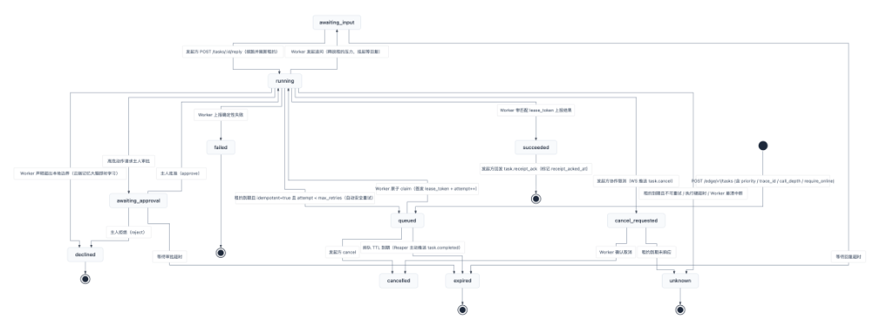

# AnyLink 交互协议 v3 (`3.2`)

[English](README.md) · [OpenAPI 3.1](openapi.json) · [TypeScript SDK](../sdk/README.md) · [Python SDK](../sdk-python/README.md) · [MCP 适配器](../mcp/README.md)

AnyLink 是面向**个人 Agent 网络（Personal Agent Network）**的引擎无关交互协议：

- **边缘自治**：每台设备（Mac、Linux、Windows、Android、服务器或脚本）只需管好自己所在的本地环境与安全边界，无需事先维护其他设备的能力清单。
- **云端统一模型网关**：多模型、多提供商 OpenAI 兼容透传，按 Agent 并发控制，支持可选自动共享记忆注入（`X-AnyLink-Auto-Memory: on`）与**断线脱钩续接**（`X-AnyLink-Detach-On-Disconnect: on` + `GET /model/v1/requests/:id`）。
- **云端记忆大脑（Cloud Memory Brain）**：统一调度与管理跨设备记忆——混合检索与上下文组装（`POST /edge/v1/memory/assemble`）、对话与任务事件异步摄入（`POST /edge/v1/memory/ingest`，含启动崩溃恢复与按 Owner 串行锁）、LLM 驱动的提取/去重/合并/作用域分配，以及**跨设备能力边界自动学习**。
- **无能力前置约束的跨设备调用**：边缘 Agent 直接按目标设备或 Agent 发送意图/任务；若目标设备无法完成，由目标 Agent 返回 `declined`（或 `failed`）并说明原因，云端记忆大脑自动将其沉淀为设备边界记忆，后续各设备加载上下文后自然避开无效派发。
- **弱网加固 WebSocket 实时总线（`GET /edge/v1/ws`）**：单调 `edge_events` 序列游标断点续传（`resume_after_seq`）、回执送达 ACK（`task.receipt_ack`）、僵尸连接心跳剔除与背压断连、Fencing Token 防脑裂（`409 LEASE_FENCED`）、人机协同挂起（`awaiting_input` / `awaiting_approval`）与二进制大附件直传（`/edge/v1/artifacts`）——并完整保留 HTTP 降级接口。

## 任务状态机（`3.2`）

  

## 1. 身份与接入

身份层级：`主人 (Owner) → 设备 (Device) → Agent`。

1. **接入（`POST /edge/v1/connect`）**：携带 `Authorization: Bearer <ANYLINK_JOIN_KEY>`（或预设 `ANYLINK_LOGIN_PASSWORD`），提交 `device: { install_id, name, platform, slug? }` 与 `agent: { key, name, kind?, summary? }`。`slug` 为唯一短别名（如 `home-mac`、`gpu-box`，省略时自动生成唯一短别名），用于消除同名设备歧义。返回 `201`、`device_slug`、一次性 `ak_` 令牌与 `protocol: { name: "anylink", version: "3.2" }`。同一 `(install_id, agent.key)` 重连保留原 ID 并轮换令牌。
2. **协议协商（`GET /edge/v1/protocol`，兼容别名 `GET /edge/v1/link/protocol`）**：返回 `version: "3.2"`、能力特性清单、传输端点与路由模式（含 `device_slug`）。
3. **节点与设备简介（`PATCH /edge/v1/agent/profile`、`PATCH /edge/v1/device/profile`）**：可选更新 Agent 简介或设备名称 / 唯一短别名 `slug`（纯标识信息，不作为任务准入门槛）。

## 2. 云端记忆大脑

- **作用域**：`global`（跨设备共享）、`device`（单设备有效，仅本设备或主人可改删）、`agent`（单 Agent 私有）。
- **记忆类别（`kind`）**：`fact`（事实）、`preference`（偏好）、`boundary`（设备能力边界）、`episode`（事件摘要）。
- **`POST /edge/v1/memory/assemble`**：根据当前 `query`、设备/Agent 身份与预算，综合中英文分词匹配 + 可选向量相似度 + 时间衰减 + 重要度，返回相关长期记忆、跨设备近期事件摘要、设备能力边界及可直接拼入系统提示词的 `summary_text`。
- **`POST /edge/v1/memory/ingest`**：边缘上报对话轮次、任务结果或观察记录；内置**短闲聊过滤**（如“好的/你好”直接跳过不消耗模型）与**按会话去抖批处理**（默认窗口 15 秒 / 满 6 条自动合并为单次云端记忆 Agent 调用；跨设备拒绝/失败边界会立即整理落盘，未配置模型密钥时自动降级为确定性摘要与边界记录）。
- **`GET /edge/v1/context` & 显式记忆 CRUD**：保留三层快照与显式增删改查（含 `expected_revision` / `If-Match` 乐观锁与幂等键）。

## 3. 云端模型网关

- **`GET /model/v1/models`**：列出已配置的模型与别名（如 `default`、各提供商模型）。
- **`POST /model/v1/chat/completions`**：标准 OpenAI 兼容 JSON / SSE 流式转发，按 Agent 并发控制。
  - **可选自动记忆模式（1A）**：携带请求头 `X-AnyLink-Auto-Memory: on`（或服务端开启 `ANYLINK_AUTO_MEMORY_DEFAULT=true`），网关会在推理前自动组装共享记忆注入上下文，并在回复完成后异步摄入记忆大脑。
  - **SSE 断线脱钩续接（`3.2`）**：携带请求头 `X-AnyLink-Detach-On-Disconnect: on` 后，响应头会返回 `X-AnyLink-Request-Id`；若中途手机/边缘断线，云端将继续跑完上游生成并缓存 15 分钟，重连后调用 **`GET /model/v1/requests/:id`** 即可拉回完整响应。
- **`POST /model/v1/speech`**：可选语音播报端点，支持 `style`（`neutral` / `persona`）、`rewrite`（`auto` / `always` / `never`）、音色与语速音调参数。

## 4. 跨设备任务、人机协同与 WebSocket 实时总线（`3.2`）

状态机：`queued` → `running`（含 `attempt`、`lease_token`、`lease_expires_at` 与可选 `max_execution_seconds`）⇄ `awaiting_input` | `awaiting_approval` → `succeeded` | `failed` | `declined` | `cancelled` | `unknown` | `expired`（运行中取消为 `cancel_requested`）。

- **创建任务与队列治理（`POST /edge/v1/tasks`，兼容 `POST /edge/v1/link/tasks`）**：
  - 支持 `priority`（0–100）、`require_online`（离线直接 `409 TARGET_OFFLINE`）、`concurrency_key`（资源级串行互斥）、`idempotent` + `max_retries`（只读幂等任务租约过期自动安全重试）、`max_execution_seconds`（硬执行上限）、`trace_id` / `parent_task_id` / `call_depth`（防循环递归 `409 CALL_DEPTH_EXCEEDED`），以及队列水位保护（`429 QUEUE_FULL`）。
- **Fencing Token 与人机协同**：
  - `claim` 原子签发递增 `attempt` 与随机 `lease_token`；后续 `heartbeat` / `progress` / `suspend` / `result` 须携带匹配 `lease_token`，失联复活的旧 Worker 将收到 `409 LEASE_FENCED` 并立刻中止本地执行。
  - Worker 可通过 `POST /edge/v1/tasks/:id/suspend`（或 WS `task.suspend`）进入 `awaiting_input` / `awaiting_approval` 并暂停租约倒计时；发起方通过 `POST /edge/v1/tasks/:id/reply`（或 WS `task.reply`）恢复执行。
- **事件游标与回执 ACK**：
  - `GET /edge/v1/ws?resume_after_seq=<n>` 与 `GET /edge/v1/events?after_seq=<n>` 支持按单调序列号无漏重放；发起方收到 `task.completed` 后须回复 `task.receipt_ack`（或 `POST /edge/v1/tasks/:id/ack`），未确认的回执将在下次重连时自动补发。
- **二进制附件流式直传（`/edge/v1/artifacts`）**：
  - `POST /edge/v1/artifacts`、`GET /edge/v1/artifacts/:id`、`GET /edge/v1/artifacts/:id/meta`、`DELETE /edge/v1/artifacts/:id` 采用零内存流式读写与独立磁盘卷存储，默认单文件 ≤200 MiB（环境变量可调至 1 GiB）、总配额 2 GiB、SHA-256 校验与 TTL 自动清理，任务载荷只需传递 `artifact_id`。
